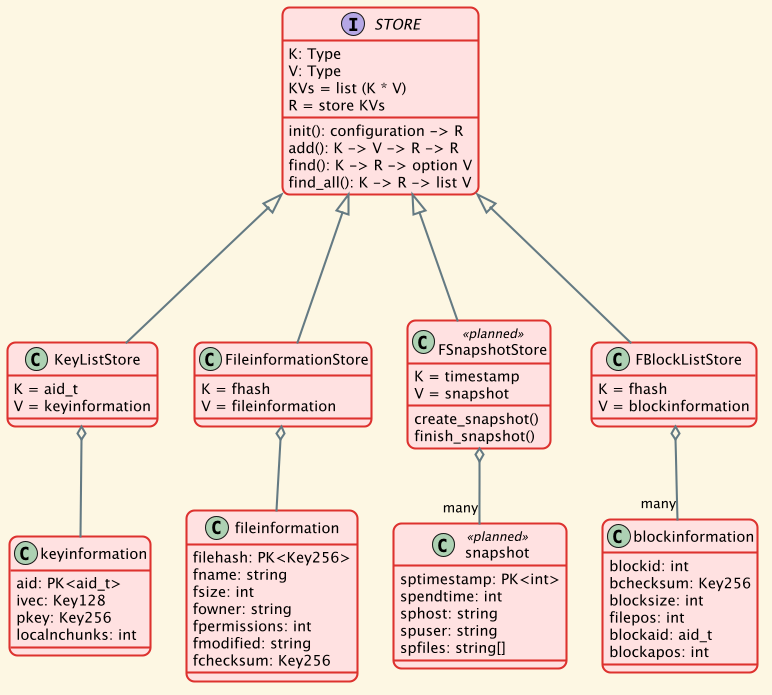
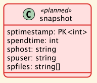
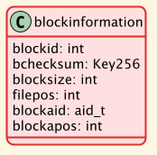

# Data Store

The eLyKseeR system stores meta information about the files and their information when running backups. The assemblies are encrypted and their encryption keys are stored as well. On a restore, these data are available again.



## Database tables

### KeyListStore

Stores the encryption keys per assembly.

K = aid_t (which is a Key256; 64 chars hex representation)

```sql
CREATE TABLE keyinformation (
    aid CHAR(64) PRIMARY KEY NOT NULL,
    ivec CHAR(32) NOT NULL,
    pkey CHAR(64) NOT NULL,
    localnchunks USMALLINT NOT NULL   -- number of chunks of this assembly (16..256)
);
```

### FileInformationStore

Stores meta data about the file.

K = fhash (which is a Key256; 64 chars hex representation)


```sql
CREATE TABLE fileinformation (
    filehash CHAR(64) PRIMARY KEY NOT NULL,
    fname VARCHAR NOT NULL,
    fsize UBIGINT NOT NULL,
    fowner VARCHAR NOT NULL,
    fpermissions USMALLINT NOT NULL,
    fmodified TIMESTAMP NOT NULL,
    fchecksum CHAR(64) NOT NULL
);
```

### SnapshotStore (planned)

> **Planned.** This store is part of the model but is not (yet) implemented in [elykseer-ml](https://github.com/eLyKseeR) (v0.10.3): the code only has a placeholder type `snapshot_t = positive`, and `fileinformation`, `blockinformation` and `assemblyinformation` carry no snapshot reference.

Stores additional information about a backup run (snapshot).

K = timestamp (requires good resolution, below 1 s)



```sql
CREATE TABLE snapshot (
    sptimestamp TIMESTAMP PRIMARY KEY NOT NULL,
    spendtime TIMESTAMP,
    sphost VARCHAR,
    spuser VARCHAR
);
```

and list all files in the snapshot:

```sql
CREATE TABLE snapshotfilerel (
    sptimestamp TIMESTAMP NOT NULL,
    spfhash CHAR(64) NOT NULL
);
```


### FBlockListStore

Stores the blocks of a file.

K = fhash (which is a Key256; 64 chars hex representation)



```sql
CREATE TABLE blockinformation (
    blockid INTEGER NOT NULL,
    bchecksum CHAR(64) NOT NULL,
    blocksize UBIGINT NOT NULL,
    filepos UBIGINT NOT NULL,
    blockaid VARCHAR NOT NULL,
    blockapos UBIGINT NOT NULL
);
```

The blocks of a file are found by the key `fhash` of the store (`FBlockListStore.find_all`); `blockid` numbers the blocks of a file. `bchecksum` is used for deduplication when a file is backed up again, and is verified when a block is read from an assembly. A block is located by `blockaid` (the assembly), `blockapos` (the position inside the assembly) and `filepos` (the position inside the file).

## Dependencies among tables (planned, with snapshots)

> **Planned.** The following applies once the [snapshot](./03-Snapshot.md) is implemented.

We can declare foreign keys to place constraints on the actions we can do with prefilled database tables.

The tables 'blockinformation' and 'fileinformation' would get an additional column `bsnapshot` / `fsnapshot` pointing to a snapshot (the key of 'blockinformation' then also includes the snapshot).

```sql
CREATE TABLE blockinformation (
    bfhash CHAR(64) NOT NULL,
    bsnapshot TIMESTAMP NOT NULL REFERENCES "snapshot" ON DELETE RESTRICT,
    ..
    PRIMARY KEY (bfhash, bsnapshot, blockid)
);
```

```sql
CREATE TABLE fileinformation (
    filehash CHAR(64) PRIMARY KEY NOT NULL,
    fsnapshot TIMESTAMP NOT NULL REFERENCES "snapshot" ON DELETE RESTRICT,
    ..
);
```

The table 'snapshotfilerel' references 'fileinformation' and 'snapshot':
```sql
CREATE TABLE snapshotfilerel (
    sptimestamp TIMESTAMP NOT NULL REFERENCES "snapshot" ON DELETE RESTRICT,
    spfhash CHAR(64) NOT NULL REFERENCES "fileinformation" ON DELETE RESTRICT
);
```
