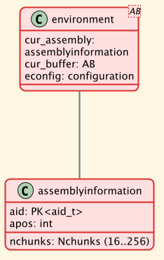

# Assemblies

File data is entered into assemblies in a non-local way and the assembly is then encrypted with strong cryptographic keys.

## Assembly states
An assembly can be in one of three states.

### AssemblyPlainWritable

In this state the assembly is writable that is data can be added: `backup()` (which also yields the `blockinformation` of the added block)

It can also transition to an [AssemblyPlainFull](#assemblyplainfull): `finish()`

At creation, the head of the buffer is filled with random bytes. The last bytes of the last chunk are reserved for the authentication tag of the encryption (AES-256-GCM); they are not available for data.

### AssemblyPlainFull

In this state an assembly can only be read from: `restore()`

Or, it can be encrypted and thus transition to [AssemblyEncrypted](#assemblyencrypted): `encrypt()`. Encryption and decryption can fail, hence they return an `option`.

### AssemblyEncrypted

An assembly that is recalled (`recall()`) from chunks is in this state.

It can be extracted into chunks: `extract()`

Or, it can be decrypted with the matching encryption keys: `decrypt()`

## Assembly methods

### creation

An assembly is created with a reference to `configuration` which defines the size of the assembly by the number of chunks it can hold. This size is between 16 and 256 chunks (the dependent type `Nchunks`). A chunk is 256 KiB (256 x 1024 bytes).

### state

At creation, a unique 256 bit `aid` is created from random bits.

The assembly remembers its size in `nchunks`.

And the field `apos` points to the next write location in the assembly's buffer.

# Environment

Related to assemblies are _environments_ that give access to assemblies and manage those.

Each environment contains the information about the assembly and the current buffer.

An environment exists in two distinct states: writable or readable.

### EnvironmentWritable

Holds an [AssemblyPlainWritable](#assemblyplainwritable).

* `initial_environment()` creates an empty assembly from a `configuration`.
* `backup()` adds a block of file content. When the free space in the assembly is too small for the block, the assembly is finalised first and a fresh one is created. The result contains the `blockinformation` of the block and, if an assembly was finalised, its `aid` with the new `keyinformation`.
* `finalise_assembly()` finishes, encrypts and extracts the assembly to chunks, and returns its `aid` and `keyinformation` (fresh random key and IV). An empty assembly is not finalised. It fails if not all chunks could be written.
* `finalise_and_recreate_assembly()` does the same and returns the environment with a fresh assembly.

### EnvironmentReadable

Holds an [AssemblyPlainFull](#assemblyplainfull).

* `restore_assembly()` recalls the chunks of an assembly given its `aid` and `keyinformation`, and decrypts them. The size of the assembly is the one stored in `localnchunks` of the key, not the currently configured one.
