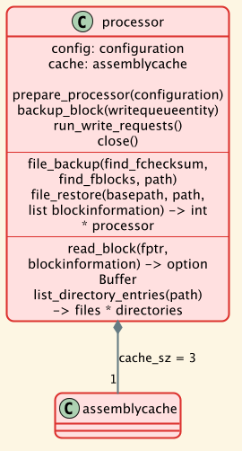

# Processor

The _Processor_ drives the backup and restore of files on top of the [AssemblyCache](./04-AssemblyCache.md). It holds a `configuration` and an assembly cache (`cache_sz` = 3 readable assemblies).

* `prepare_processor()` creates the processor and its assembly cache.
* `backup_block()` enqueues a block for writing. If the write queue is full, it is run first.
* `run_write_requests()` runs the write queue.
* `close()` closes the assembly cache: the open assembly is encrypted and extracted to chunks.
* `file_backup()` and `file_restore()` handle a whole file, see below.
* `read_block()` reads a block from an open file. It fails on a short read (the file shrank since the blocks were planned).
* `list_directory_entries()` lists the regular files and the directories of a directory. Symbolic links are skipped.

## File backup

A file is cut into blocks of `block_sz` = 32768 bytes (`prepare_blocks`). Two levels of deduplication avoid writing known data again:

1. the checksum of the file is equal to the one in the meta data: the file is skipped.
2. the checksum of a block is equal to the one of the block in the meta data: the existing `blockinformation` is kept, and the block is not written.

All other blocks are enqueued as write requests. At the end, the `fileinformation` is added.

## File restore

A file that already exists is not overwritten. Missing parent directories are created. Each block becomes a read request (assembly, position in assembly, length, position in file, checksum); the returned data is written at its position in the file. The result is the number of bytes written.
